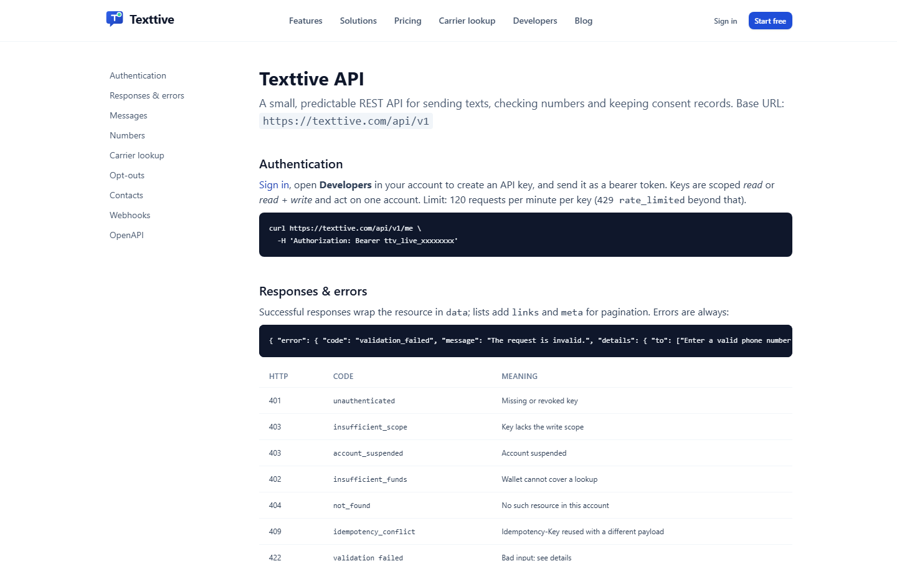
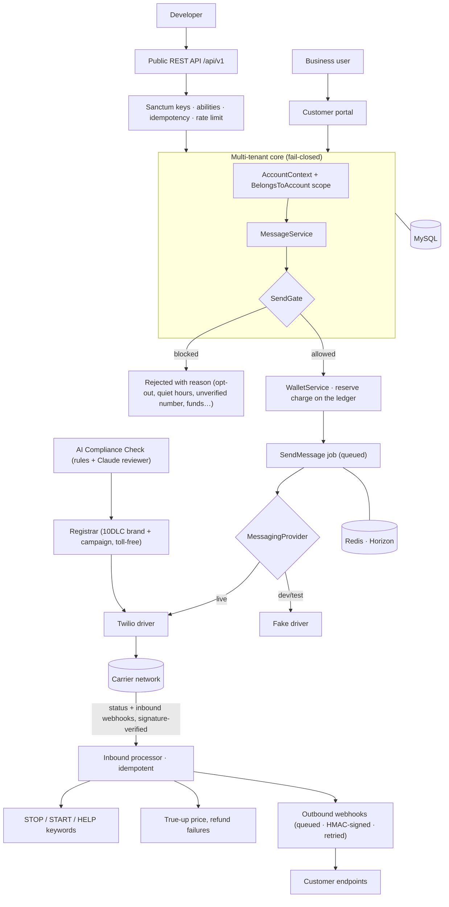

<p align="center">
  
</p>

<h1 align="center">Texttive — Case Study</h1>

<p align="center">
  <b>A prepaid, compliance-first business texting platform with a public REST API.</b><br>
  Laravel 13 · PHP 8.3 · MySQL · Redis + Horizon · Twilio · Stripe · Tailwind
</p>

---

Texttive gives a business a phone number it owns, a two-way inbox, templates and bulk
campaigns, carrier lookup, and a wallet it tops up as it goes. The hard part of business
texting in the US is not sending the message; it is staying allowed to send. Carriers block
unregistered senders, fine unwanted texts, and reject registrations for a missing sentence on
a privacy page. Texttive treats that as an engineering problem: opt-outs, quiet hours and
carrier registration are enforced in code, and a single gate decides whether any message may
leave.

This repository is a **portfolio case study**: a public overview of the architecture and
engineering. The full application source is private and available to reviewers on request.

> **Status:** live in production with an approved 10DLC campaign delivering real traffic.

---

## The product

<p align="center">
  
</p>

**What businesses can do**

| | |
|---|---|
| **Numbers they own** | Search by area code, buy local (10DLC) or toll-free numbers, release any time. Each renews monthly from the wallet. |
| **Two-way inbox** | Conversations per number, contacts and lists with CSV import, templates with merge fields, scheduled sends, throttled bulk campaigns. |
| **Compliance built in** | STOP / START / HELP handled automatically, an opt-out list that is never deleted, TCPA quiet hours in the account's timezone, and guided 10DLC or toll-free registration filed with the carrier registry on the customer's behalf. |
| **AI Compliance Check** | Reads the customer's website the way a carrier reviewer does and returns a graded report with exact fixes, before they file and pay a vetting fee. |
| **Prepaid wallet** | Stripe top-ups, a transparent rate card with carrier fees passed through at cost, an append-only ledger, spend limits, low-balance alerts, exports. |
| **Carrier lookup** | Line type, carrier and deliverability for one number or a CSV of thousands, with free credits on every account. |
| **Smart Replies** | An optional AI add-on that drafts inbox replies and, when enabled, answers routine texts on its own: confidence-gated, silent while a person is active in the thread, hands off on request, disclosed once per conversation. |
| **Agencies** | Sub-accounts, role-based team access, branded transactional email. |

**What developers can do** — a full REST API: account-scoped keys with `read` / `write`
abilities, idempotent sends, per-key rate limiting, and outbound **signed webhooks** for
message status and inbound texts, with retries and a delivery log.

<p align="center">
  
</p>

<p align="center">
  
</p>

---

## Architecture



### Engineering highlights

**One decision point for "may this message go out?"** A single `SendGate` runs at dispatch
time and again inside the queued job, because state can change in between. Its checks are
ordered and every one fails closed; any exception blocks the send. Every rule ships with a
test that proves it blocks.

```text
account active & sending enabled
→ number owned & active
→ number's 10DLC campaign / toll-free verification approved
→ recipient not opted out
→ destination country allowed
→ quiet hours (TCPA, account timezone)
→ wallet covers the estimated price (segments × rate)
→ daily spend limit
```

**Fail-closed multi-tenancy.** Every tenant-owned model carries a global scope fed by an
ambient account context. With no account in context the scope returns *zero* rows, never
all. Crossing tenants is an explicit call that stands out in code review.

**Money is decimal strings, never floats.** Prices go to six decimal places (a lookup is a
fraction of a cent), so all arithmetic runs through one bcmath helper. The wallet is an
append-only ledger with a single writer: a charge is reserved when a message is queued, then
trued up from the carrier's reported segment count, and refunded automatically if the
message never reaches a carrier.

**Providers behind seams.** Twilio is the only carrier today, but domain code never sees it.
Messaging, registration, payments and the AI reviewer each sit behind a contract with a
Fake implementation, which is how the entire test suite runs end to end without a network
call.

```php
// Every provider seam has a Fake, bound automatically when no credentials are set.
MessagingProvider  → TwilioProvider  | FakeProvider
Registrar          → TwilioRegistrar | FakeRegistrar
PaymentGateway     → StripeGateway   | FakeGateway
Reviewer           → ClaudeReviewer  | FakeReviewer
```

**Compliance encoded from real rejections.** The campaign behind the live site was rejected
several times before approval. Each carrier rejection reason became a rule in the readiness
checker (bundled consent, unverifiable opt-in calls to action, missing policy sentences,
prohibited content categories) and a paragraph in the in-app guides, so customers see the
problem before the registry does. An optional Claude review adds the judgement calls a human
reviewer would make; the rule-based checks stand on their own without it.

**Webhooks in both directions.** Inbound carrier and payment webhooks are signature-verified
before parsing and recorded idempotently on the provider's event id. Outbound webhooks are
signed over the timestamp and body, delivered by a queued job with backoff, logged per
attempt, and refused at registration if they point at a private or loopback address.

**Signup abuse defences.** A honeypot, an HMAC-signed minimum-time token, per-IP limits,
disposable-domain and MX checks, optional Cloudflare Turnstile, and IP intelligence recorded
on the account for the human approval step. Network checks fail open so a slow third party
never blocks a real customer; the cheap checks fail closed. The invite-only tester programme
goes one step further with **double opt-in**: an application holds no spot until its emailed
link is clicked, so a flood of form posts cannot move the capped counter; unconfirmed rows
are pruned after a week, and a blocked bot sees the ordinary success screen with nothing
stored and no email sent.

**AI on a short leash.** The Smart Replies add-on never gets the keys. The model sees only
the thread, the account's own knowledge base and templates, must return a structured
decision, and may send only above a confidence threshold. Hand-off words, a human-active
window, daily caps, after-hours rules and keyword messages short-circuit before any model
call. Every automated send passes the same gate and ledger as a human one, and the add-on
pauses itself when the wallet cannot cover its renewal.

```php
// Signed "form rendered at" token: a submission younger than a few seconds is a bot.
$token = $at.'.'.substr(hash_hmac('sha256', (string) $at, $appKey), 0, 20);
```

---

## Tech stack

- **Backend:** PHP 8.3, Laravel 13, Fortify (auth, 2FA), Sanctum (account-scoped API keys)
- **Data:** MySQL 8, Redis (cache, sessions, queue) with Horizon
- **Carrier:** Twilio (messaging, Lookup v2, 10DLC and toll-free registration APIs)
- **Payments and mail:** Stripe Checkout, Mailgun with branded Markdown templates
- **AI:** Anthropic Claude for the optional website review and the Smart Replies add-on, each behind a contract with a Fake
- **Frontend:** Blade + Tailwind CSS v4 + inline Lucide icons, built with Vite; no SPA framework
- **Testing:** Pest feature suite (251 tests) running entirely on the Fake providers

---

## About

Designed and built by **Jessie Martin**.

- 📧 [nvitguru@gmail.com](mailto:nvitguru@gmail.com)
- The complete source is maintained privately and can be shared with reviewers on request.

---

<sub>© 2026 Jessie Martin. All rights reserved. This case study is for evaluation of the
author's work. "Texttive" branding belongs to its owner; Twilio, Stripe, Mailgun and
Anthropic are trademarks of their respective owners. Texttive never stores card numbers. See
<a href="LICENSE">LICENSE</a>.</sub>
