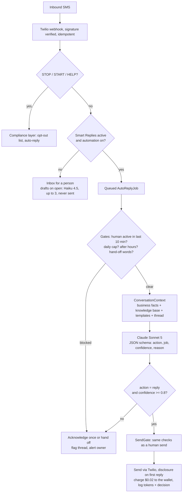
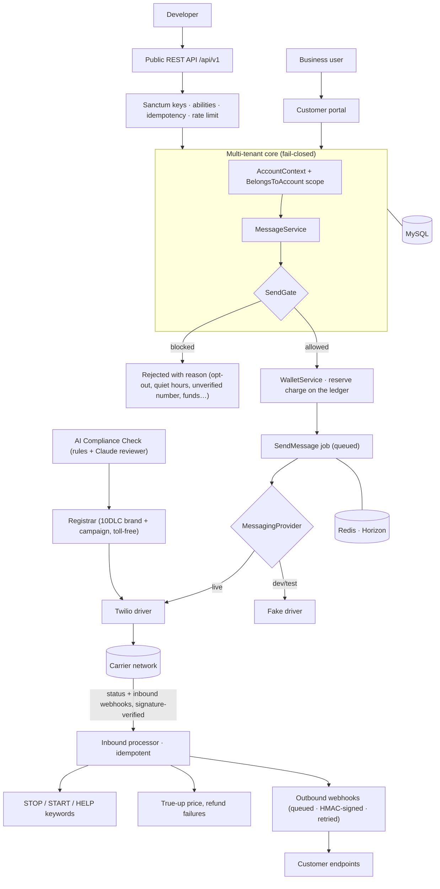

<p align="center">
  
</p>

<h1 align="center">Texttive: Case Study</h1>

<p align="center">
  <b>A prepaid, compliance-first business texting platform with a public REST API.</b><br>
  Laravel 13 · PHP 8.3 · MySQL · Redis + Horizon · Twilio · Stripe · Tailwind
</p>

---

Texttive gives a business a phone number it owns, a two-way inbox, templates and bulk
campaigns, carrier lookup, and a wallet it tops up as it goes. The hard part of business
texting in the US is not sending the message; it is staying allowed to send. Carriers block
unregistered senders, fine unwanted texts, and reject registrations for a missing sentence on
a privacy page. Texttive treats that as an engineering problem: opt-outs, quiet hours and
carrier registration are enforced in code, and a single gate decides whether any message may
leave.

This repository is a **portfolio case study**: a public overview of the architecture and
engineering. The full application source is private and available to reviewers on request.

> **Status:** live in production with an approved 10DLC campaign delivering real traffic.

---

## The AI layer

Texttive uses Claude in three places, each behind a contract with a Fake implementation so the whole test suite
runs without a network call. The design principle throughout: the model advises or drafts inside hard limits set in
code; it never gets to override a compliance rule, a wallet balance or a person.

### What the AI does

| Capability | What happens | Model |
|---|---|---|
| **Smart Replies: drafts** | When an agent opens a conversation, up to three suggested replies (each under 320 characters) appear beside the thread. Drafts are cached per conversation and never send anything; a person picks, edits and sends. | Claude Haiku 4.5 |
| **Smart Replies: automated answers** | With automation switched on, an inbound text produces a structured decision: `reply`, `handoff` or `ignore`, with a job type, a confidence score and a one-line reason. A reply goes out only at confidence 0.8 or higher and only for jobs the business enabled (for example FAQ answers stated in its knowledge base). | Claude Sonnet 5 |
| **Hand-off to a human** | If the customer asks for a person (words such as agent, human, representative), the confidence is below the threshold, or the request falls outside the enabled jobs, the assistant sends one "a member of our team will get back to you" message, flags the thread and emails the account owner and admins. Once a human replies, the assistant stays out of that thread for 10 minutes and the flag clears. | none |
| **Knowledge base import** | The business pastes its website address; the importer fetches its own pages (about, services, pricing, contact first) and the model distils them into one fact per line, "only facts that appear on the pages, never inferred or invented". Hand-written facts are added on top, capped at 12,000 characters. | Claude Sonnet 5 |
| **AI Compliance Check** | Before a business files a 10DLC campaign, a rule engine reads its privacy policy, terms and opt-in description the way a carrier reviewer does (the no-sharing sentence, terms elements, bundled consent, prohibited content categories, each mapped to the carrier's rejection code). An optional model review then adds the judgement calls: structured findings, a summary and a prediction of `likely_approved` or `at_risk`. The rules stand on their own when the model is off. | Claude Opus 5 |

### How it is built

- **API and SDK.** The official Anthropic PHP SDK (v0.50) against the Messages API, with **structured outputs**: every call
  declares a JSON schema in the request's output format, so the application parses typed JSON (action, confidence,
  reason, findings) instead of scraping prose. A refusal stop reason or a transport error yields an empty, typed result
  and the request is treated as "assistant unavailable", which routes to a human. The driver never throws into the
  messaging pipeline.
- **Model choice per job.** Haiku 4.5 drafts (cheap, fast, a person reads the output), Sonnet 5 decides whether to
  answer on its own and distils knowledge bases, Opus 5 reviews compliance pages. All three are configurable per
  environment without a code change.
- **Key management.** One workspace-scoped Anthropic API key, read from the server environment only. It is never in
  the repository, the browser or a log line, and usage is attributable to this product in the Anthropic console.
- **Grounding.** The model sees exactly what `ConversationContext` assembles: the business's name and description,
  its knowledge base, its message templates, its hours, and the current thread. Nothing from other accounts, no
  database access, no tools. The system prompt also forbids the model from repeating any name that appears in the
  thread other than the customer's own, from inventing prices or availability, and from claiming to be a person.
- **Guardrails the model cannot cross.**
  - STOP, START and HELP keywords are handled by the compliance layer before any AI code runs; the model never sees them.
  - An automated reply is sent through the same `SendGate` as a human one: account active, registration approved,
    recipient not opted out, destination allowed, quiet hours, wallet covers the price. The AI has no separate path.
  - The first automated reply in a conversation carries a disclosure ("This is an automated reply. Text AGENT to reach a person.").
  - A per-account daily cap (default 50 automated replies), an after-hours mode that acknowledges once per conversation
    per day without calling the model, and the 10-minute human-active window keep the assistant from talking over people.
- **Metering and pricing.** The add-on bills $19 a month plus $0.02 per automated reply from the prepaid wallet, with a
  trial of 14 days or 50 automated replies, whichever ends first. Each automated send is charged under its own
  idempotency key, so a retried job can never double-bill. Renewals run daily; if the wallet cannot cover one, the add-on
  pauses itself rather than driving the balance negative, and reactivation charges the month at that moment.
- **Cost control.** Every call is bounded by `max_tokens`, drafts are cached per conversation and regenerated only when
  a new inbound message arrives, suggestions are generated only for accounts with the add-on active, and the token
  usage and model of every call are written to the audit log (`ai.suggested`, `ai.decision`, `ai.handoff`,
  `ai.cap_reached`) so spend can be reconciled per account.

### Message-to-reply flow



### Evaluation and monitoring

Only figures that can be read back from the system are listed here.

- **Tests.** 11 Smart Replies tests and 14 AI Compliance Check tests inside a 260-test suite, all run against the Fake
  driver. They prove, among other things, that drafts never send, that an automated answer carries the disclosure
  once and is charged once, that keywords, automation off and the daily cap keep the assistant silent, that asking for
  a person hands off exactly once and alerts the owner, that after-hours acknowledgements make no model call, and that
  the trial ends at 50 replies with the first month charged.
- **First live session (our own line, 2 October 2026).** One draft set of three suggestions used 481 tokens on
  Haiku 4.5. Four automated decisions on Sonnet 5 used between 2,161 and 2,560 tokens each: three were answered from
  the knowledge base at confidence 0.8 to 0.9, and one (a request to schedule a meeting with a named person, outside
  the knowledge base) came back at 0.6 and was handed to a human with the reason recorded. That is the threshold
  doing its job on the first day.
- **Recorded per call:** model, input and output tokens, action, job, confidence, and the model's stated reason.
- **Not yet measured:** per-call latency and dollar cost per reply. Token counts are already logged; a latency field and a
  cost roll-up per account are the next additions.

---

## The product

<p align="center">
  
</p>

**What businesses can do**

| | |
|---|---|
| **Numbers they own** | Search by area code, buy local (10DLC) or toll-free numbers, release any time. Each renews monthly from the wallet. |
| **Two-way inbox** | Conversations per number, contacts and lists with CSV import, templates with merge fields, scheduled sends, throttled bulk campaigns. |
| **Compliance built in** | STOP / START / HELP handled automatically, an opt-out list that is never deleted, TCPA quiet hours in the account's timezone, and guided 10DLC or toll-free registration filed with the carrier registry on the customer's behalf. |
| **AI Compliance Check** | Reads the customer's website the way a carrier reviewer does and returns a graded report with exact fixes, before they file and pay a vetting fee. |
| **Prepaid wallet** | Stripe top-ups, a transparent rate card with carrier fees passed through at cost, an append-only ledger, spend limits, low-balance alerts, exports. |
| **Carrier lookup** | Line type, carrier and deliverability for one number or a CSV of thousands, with free credits on every account. |
| **Smart Replies** | An optional AI add-on that drafts inbox replies and, when enabled, answers routine texts on its own: confidence-gated, silent while a person is active in the thread, hands off on request, disclosed once per conversation. |
| **Agencies** | Sub-accounts, role-based team access, branded transactional email. |

**What developers can do**: a full REST API: account-scoped keys with `read` / `write`
abilities, idempotent sends, per-key rate limiting, and outbound **signed webhooks** for
message status and inbound texts, with retries and a delivery log.

<p align="center">
  
</p>

<p align="center">
  
</p>

---

## Architecture



### Engineering highlights

**One decision point for "may this message go out?"** A single `SendGate` runs at dispatch
time and again inside the queued job, because state can change in between. Its checks are
ordered and every one fails closed; any exception blocks the send. Every rule ships with a
test that proves it blocks.

```text
account active & sending enabled
→ number owned & active
→ number's 10DLC campaign / toll-free verification approved
→ recipient not opted out
→ destination country allowed
→ quiet hours (TCPA, account timezone)
→ wallet covers the estimated price (segments × rate)
→ daily spend limit
```

**Fail-closed multi-tenancy.** Every tenant-owned model carries a global scope fed by an
ambient account context. With no account in context the scope returns *zero* rows, never
all. Crossing tenants is an explicit call that stands out in code review.

**Money is decimal strings, never floats.** Prices go to six decimal places (a lookup is a
fraction of a cent), so all arithmetic runs through one bcmath helper. The wallet is an
append-only ledger with a single writer: a charge is reserved when a message is queued, then
trued up from the carrier's reported segment count, and refunded automatically if the
message never reaches a carrier.

**Providers behind seams.** Twilio is the only carrier today, but domain code never sees it.
Messaging, registration, payments and the AI reviewer each sit behind a contract with a
Fake implementation, which is how the entire test suite runs end to end without a network
call.

```php
// Every provider seam has a Fake, bound automatically when no credentials are set.
MessagingProvider  → TwilioProvider  | FakeProvider
Registrar          → TwilioRegistrar | FakeRegistrar
PaymentGateway     → StripeGateway   | FakeGateway
Reviewer           → ClaudeReviewer  | FakeReviewer
```

**Compliance encoded from real rejections.** The campaign behind the live site was rejected
several times before approval. Each carrier rejection reason became a rule in the readiness
checker (bundled consent, unverifiable opt-in calls to action, missing policy sentences,
prohibited content categories) and a paragraph in the in-app guides, so customers see the
problem before the registry does. An optional Claude review adds the judgement calls a human
reviewer would make; the rule-based checks stand on their own without it.

**Webhooks in both directions.** Inbound carrier and payment webhooks are signature-verified
before parsing and recorded idempotently on the provider's event id. Outbound webhooks are
signed over the timestamp and body, delivered by a queued job with backoff, logged per
attempt, and refused at registration if they point at a private or loopback address.

**Signup abuse defences.** A honeypot, an HMAC-signed minimum-time token, per-IP limits,
disposable-domain and MX checks, optional Cloudflare Turnstile, and IP intelligence recorded
on the account for the human approval step. Network checks fail open so a slow third party
never blocks a real customer; the cheap checks fail closed. The invite-only tester programme
goes one step further with **double opt-in**: an application holds no spot until its emailed
link is clicked, so a flood of form posts cannot move the capped counter; unconfirmed rows
are pruned after a week, and a blocked bot sees the ordinary success screen with nothing
stored and no email sent.

```php
// Signed "form rendered at" token: a submission younger than a few seconds is a bot.
$token = $at.'.'.substr(hash_hmac('sha256', (string) $at, $appKey), 0, 20);
```

**AI on a short leash.** Covered in full in [The AI layer](#the-ai-layer) above: structured outputs, a
confidence gate, hand-off to a person, the same send gate and ledger as a human send, and per-call token logging.

---

## Tech stack

- **Backend:** PHP 8.3, Laravel 13, Fortify (auth, 2FA), Sanctum (account-scoped API keys)
- **Data:** MySQL 8, Redis (cache, sessions, queue) with Horizon
- **Carrier:** Twilio (messaging, Lookup v2, 10DLC and toll-free registration APIs)
- **Payments and mail:** Stripe Checkout, Mailgun with branded Markdown templates
- **AI:** Anthropic Claude via the official PHP SDK with JSON-schema structured outputs: Haiku 4.5 (drafts), Sonnet 5 (automated answers, knowledge-base distillation), Opus 5 (compliance review); each behind a contract with a Fake
- **Frontend:** Blade + Tailwind CSS v4 + inline Lucide icons, built with Vite; no SPA framework
- **Testing:** Pest feature suite (251 tests) running entirely on the Fake providers

---

## About

Designed and built by **Jessie Martin**.

- 📧 [nvitguru@gmail.com](mailto:nvitguru@gmail.com)
- The complete source is maintained privately and can be shared with reviewers on request.

---

<sub>© 2026 Jessie Martin. All rights reserved. This case study is for evaluation of the
author's work. "Texttive" branding belongs to its owner; Twilio, Stripe, Mailgun and
Anthropic are trademarks of their respective owners. Texttive never stores card numbers. See
<a href="LICENSE">LICENSE</a>.</sub>
